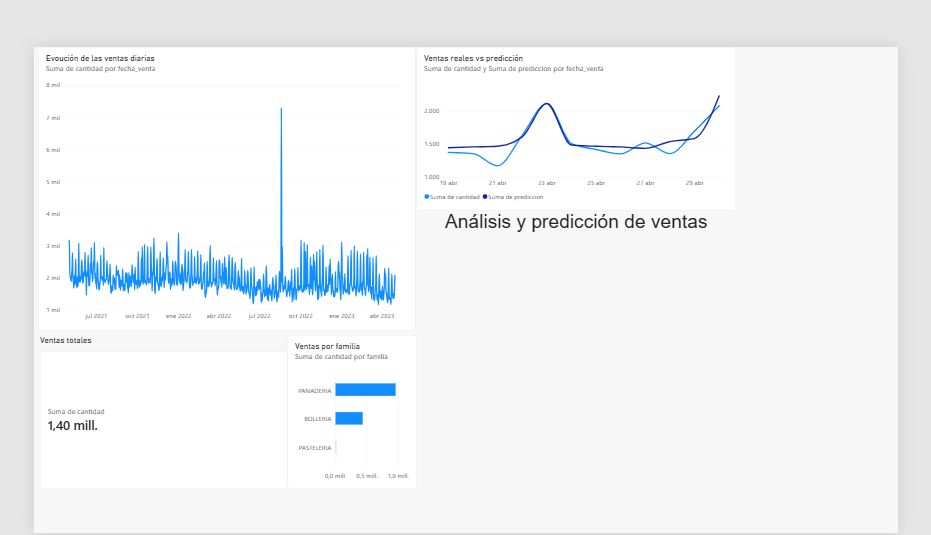
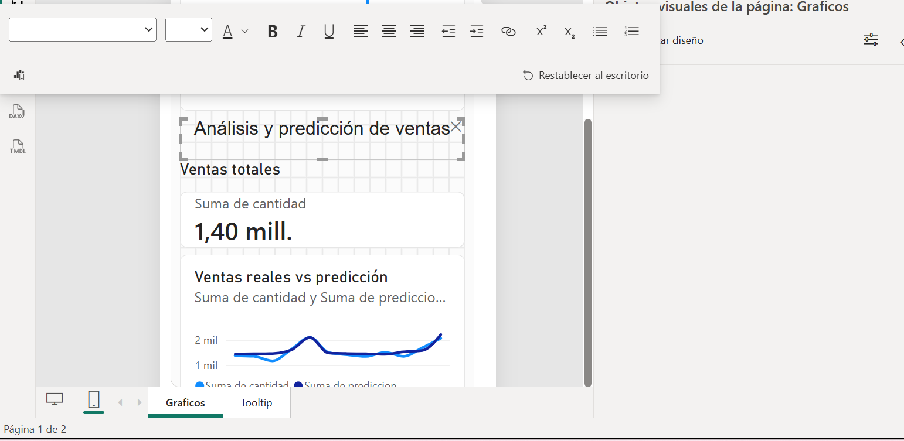

# 📊 Datathon — Predicción de ventas con Machine Learning

Proyecto end-to-end de **Data Science** desarrollado sobre datos reales de una panadería, desde la carga y exploración de datos hasta el entrenamiento, puesta en producción del modelo y visualización en Power BI.

> **Objetivo:** predecir las ventas del artículo `3960` y extender el protocolo de modelado al resto de artículos con histórico suficiente.

## 🔎 Qué incluye el proyecto

- Creación y carga de una base de datos.
- Análisis exploratorio de datos (EDA): nulos, duplicados, outliers, temporalidad y patrones de venta.
- Enriquecimiento con variables meteorológicas mediante Meteostat.
- Ingeniería de variables temporales: lags, medias móviles y calendario.
- Entrenamiento y evaluación de modelos de Machine Learning.
- Validación temporal y automatización del proceso para múltiples artículos.
- Pipeline de Scikit-Learn.
- Experiment tracking y registro de modelos con MLflow.
- Exposición del modelo mediante REST API.
- Persistencia de predicciones.
- Dashboard en Power BI con tooltip y diseño móvil.

## 🧰 Stack

`Python` · `Pandas` · `NumPy` · `Scikit-Learn` · `SQL` · `MLflow` · `Meteostat` · `Power BI` · `Jupyter`

## 📁 Estructura

```text
.
├── notebooks/
│   ├── 01_BBDD_EDA.ipynb
│   ├── 02_Modelado_Predictivo.ipynb
│   └── 03_MLflow_API.ipynb
├── powerbi/
│   └── Datathon_Pame.pbix
├── assets/
│   ├── dashboard_overview.png
│   └── mobile_layout.png
├── .gitignore
├── requirements.txt
└── README.md
```

## 1️⃣ Base de datos y EDA

La primera fase cubre la creación/carga de tablas, conexión a BBDD y un análisis exploratorio orientado a comprender la calidad y el comportamiento temporal de las ventas.

Entre otros puntos se estudian:

- valores nulos y duplicados;
- distribuciones y outliers;
- evolución temporal;
- diferencias entre familias y artículos;
- estacionalidad;
- variables externas y meteorológicas.

📓 [`01_BBDD_EDA.ipynb`](notebooks/01_BBDD_EDA.ipynb)

## 2️⃣ Modelado predictivo

El caso principal se centra en el artículo **3960**. Se construyen variables temporales y se realiza una validación que respeta el orden temporal de los datos.

El protocolo se extiende después a los artículos que cuentan con histórico suficiente para aplicar el mismo criterio de evaluación.

### Resultados destacados

- **128 artículos** identificados en la base diaria consolidada.
- **92 artículos** con histórico suficiente para ejecutar el protocolo completo de forma comparable.
- Para el artículo 3960 se observa una **estacionalidad semanal relevante**.
- En la comparación realizada, Ridge obtiene aproximadamente:
  - **MAE:** 22,55
  - **RMSE:** 26,37
  - **R²:** 0,768

📓 [`02_Modelado_Predictivo.ipynb`](notebooks/02_Modelado_Predictivo.ipynb)

## 3️⃣ Pipeline, MLflow y API

La tercera fase convierte el trabajo de modelado en un flujo más cercano a producción:

- Scikit-Learn Pipeline;
- ejecución y tracking de experimentos con MLflow;
- registro del modelo;
- serving mediante REST API;
- predicciones a través de la API;
- persistencia de resultados en base de datos.

📓 [`03_MLflow_API.ipynb`](notebooks/03_MLflow_API.ipynb)

## 📊 Dashboard Power BI

El dashboard resume el análisis y permite comparar las ventas reales con las predicciones del modelo.



También se diseñó una versión específica para dispositivos móviles:



El fichero `.pbix` está disponible en [`powerbi/Datathon_Pame.pbix`](powerbi/Datathon_Pame.pbix).

## ▶️ Ejecución local

```bash
python -m venv .venv

# Windows
.venv\Scripts\activate

pip install -r requirements.txt
jupyter notebook
```

Para iniciar MLflow:

```bash
mlflow server --backend-store-uri sqlite:///mlflow.db \
  --default-artifact-root ./mlartifacts \
  --host 127.0.0.1 --port 5000
```

## 🔐 Datos y seguridad

Los datasets originales **no se incluyen en el repositorio**. Tampoco se versionan credenciales, bases de datos locales, archivos `.env`, artefactos generados por MLflow ni otros ficheros sensibles.

## 🎯 Competencias demostradas

Este proyecto demuestra un flujo completo de trabajo en Data Science:

**ingesta → BBDD → EDA → feature engineering → modelado → evaluación → MLOps → API → visualización.**

---

### Autora
**Pamela — Data Analytics & Data Science / IA**
